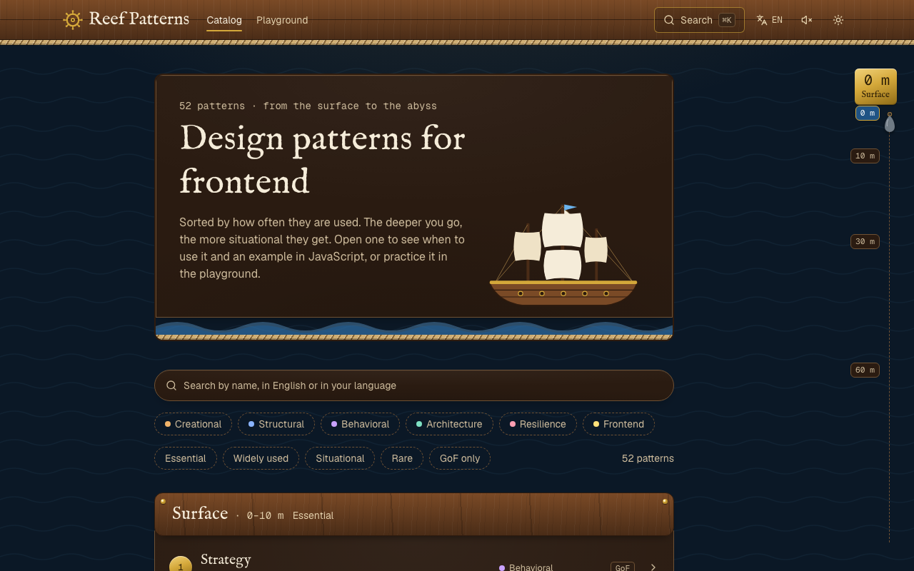
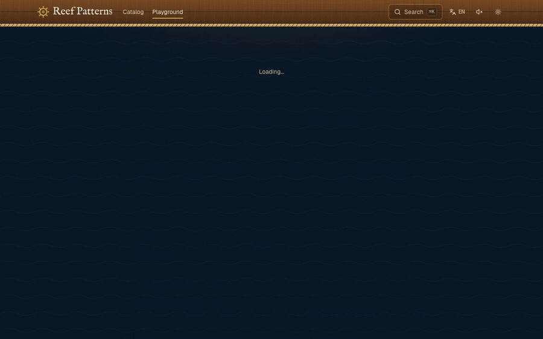
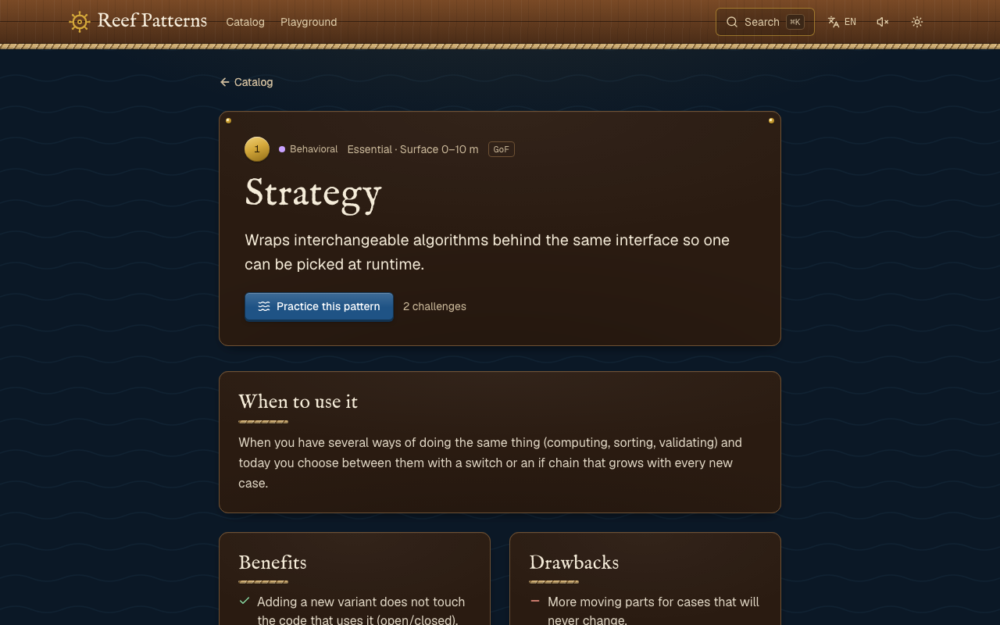
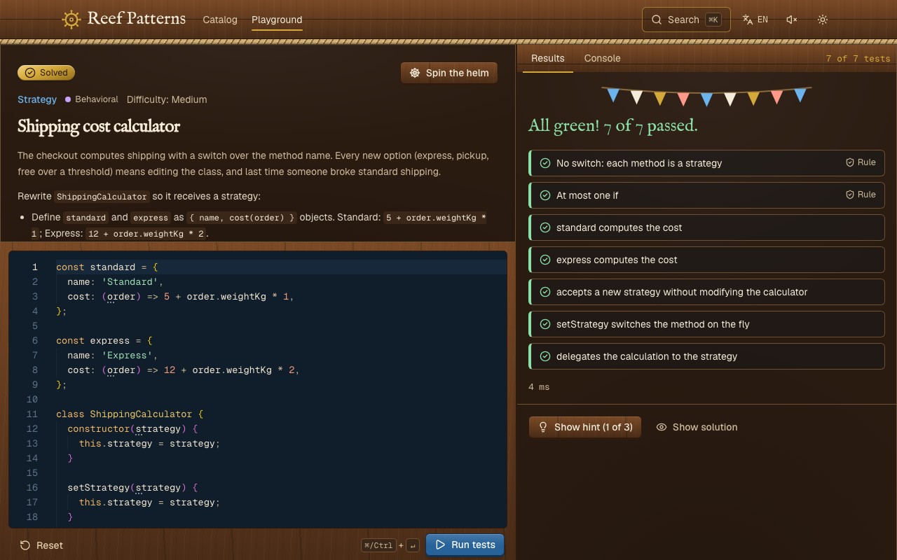

# Reef Patterns

**Learn 52 design patterns for frontend developers, then practice them with coding challenges
that run in your browser.** Free, no sign-up, in English, Spanish and Portuguese.

[](https://github.com/mtorre4580/reef-patterns/actions/workflows/ci.yml)
[](https://github.com/mtorre4580/reef-patterns/actions/workflows/deploy.yml)
[](./LICENSE)
[](https://mtorre4580.github.io/reef-patterns/)

### 👉 [Open Reef Patterns](https://mtorre4580.github.io/reef-patterns/)

<picture>
  <source media="(prefers-color-scheme: dark)" srcset="docs/media/catalog-dark.png" />
  <source media="(prefers-color-scheme: light)" srcset="docs/media/catalog-light.png" />
  
</picture>

## How it works

Spin the ship's helm to get a random challenge, write the solution in a VS Code–like editor and
run the tests right in the browser.



1. **Browse the catalog.** 52 patterns (23 from the Gang of Four, plus architecture, resilience
   and React patterns) sorted by how often you will meet them at work, from _Essential_ to _Rare_.
2. **Read a pattern.** When to use it, benefits, drawbacks, where it shows up in the JavaScript
   ecosystem and a runnable example based on a real situation: checkout, payments, API clients,
   notifications, feature flags, forms, background jobs…
3. **Practice it.** Each challenge gives you starter code and tests that only pass when the pattern
   is applied. Hints and the solution are there when you get stuck. Progress is saved locally.

<table>
  <tr>
    <td width="50%">
      <picture>
        <source media="(prefers-color-scheme: dark)" srcset="docs/media/pattern-dark.png" />
        <source media="(prefers-color-scheme: light)" srcset="docs/media/pattern-light.png" />
        
      </picture>
    </td>
    <td width="50%">
      <picture>
        <source media="(prefers-color-scheme: dark)" srcset="docs/media/playground-dark.png" />
        <source media="(prefers-color-scheme: light)" srcset="docs/media/playground-light.png" />
        
      </picture>
    </td>
  </tr>
  <tr>
    <td align="center">Pattern detail</td>
    <td align="center">Playground</td>
  </tr>
</table>

## Who is it for

- Frontend and full-stack developers who want to recognize patterns in the code they already
  write (React, Node, TypeScript).
- Anyone preparing for interviews or system-design conversations.
- Teams that want a shared vocabulary for code reviews.

## The 52 patterns

| Usage | Patterns |
| --- | --- |
| **Essential** (11) | [Strategy](https://mtorre4580.github.io/reef-patterns/patterns/strategy/) · [Observer](https://mtorre4580.github.io/reef-patterns/patterns/observer/) · [Factory Method](https://mtorre4580.github.io/reef-patterns/patterns/factory-method/) · [Singleton](https://mtorre4580.github.io/reef-patterns/patterns/singleton/) · [Decorator](https://mtorre4580.github.io/reef-patterns/patterns/decorator/) · [Adapter](https://mtorre4580.github.io/reef-patterns/patterns/adapter/) · [Facade](https://mtorre4580.github.io/reef-patterns/patterns/facade/) · [Dependency Injection](https://mtorre4580.github.io/reef-patterns/patterns/dependency-injection/) · [Builder](https://mtorre4580.github.io/reef-patterns/patterns/builder/) · [Module](https://mtorre4580.github.io/reef-patterns/patterns/module/) · [Iterator](https://mtorre4580.github.io/reef-patterns/patterns/iterator/) |
| **Widely used** (18) | [Composite](https://mtorre4580.github.io/reef-patterns/patterns/composite/) · [Command](https://mtorre4580.github.io/reef-patterns/patterns/command/) · [Proxy](https://mtorre4580.github.io/reef-patterns/patterns/proxy/) · [Repository](https://mtorre4580.github.io/reef-patterns/patterns/repository/) · [MVC](https://mtorre4580.github.io/reef-patterns/patterns/mvc/) · [MVVM](https://mtorre4580.github.io/reef-patterns/patterns/mvvm/) · [Pub/Sub](https://mtorre4580.github.io/reef-patterns/patterns/pub-sub/) · [Chain of Responsibility](https://mtorre4580.github.io/reef-patterns/patterns/chain-of-responsibility/) · [Template Method](https://mtorre4580.github.io/reef-patterns/patterns/template-method/) · [State](https://mtorre4580.github.io/reef-patterns/patterns/state/) · [Abstract Factory](https://mtorre4580.github.io/reef-patterns/patterns/abstract-factory/) · [Custom Hooks](https://mtorre4580.github.io/reef-patterns/patterns/custom-hooks/) · [Provider](https://mtorre4580.github.io/reef-patterns/patterns/provider/) · [Flux](https://mtorre4580.github.io/reef-patterns/patterns/flux/) · [Container / Presentational](https://mtorre4580.github.io/reef-patterns/patterns/container-presentational/) · [Compound Components](https://mtorre4580.github.io/reef-patterns/patterns/compound-components/) · [Higher-Order Component](https://mtorre4580.github.io/reef-patterns/patterns/hoc/) · [Render Props](https://mtorre4580.github.io/reef-patterns/patterns/render-props/) |
| **Situational** (13) | [Middleware](https://mtorre4580.github.io/reef-patterns/patterns/middleware/) · [Mediator](https://mtorre4580.github.io/reef-patterns/patterns/mediator/) · [Memento](https://mtorre4580.github.io/reef-patterns/patterns/memento/) · [Prototype](https://mtorre4580.github.io/reef-patterns/patterns/prototype/) · [Null Object](https://mtorre4580.github.io/reef-patterns/patterns/null-object/) · [Retry with Backoff](https://mtorre4580.github.io/reef-patterns/patterns/retry/) · [Circuit Breaker](https://mtorre4580.github.io/reef-patterns/patterns/circuit-breaker/) · [Debounce & Throttle](https://mtorre4580.github.io/reef-patterns/patterns/debounce-throttle/) · [Optimistic UI](https://mtorre4580.github.io/reef-patterns/patterns/optimistic-ui/) · [Lazy Loading](https://mtorre4580.github.io/reef-patterns/patterns/lazy-loading/) · [Bridge](https://mtorre4580.github.io/reef-patterns/patterns/bridge/) · [Flyweight](https://mtorre4580.github.io/reef-patterns/patterns/flyweight/) · [Plugin](https://mtorre4580.github.io/reef-patterns/patterns/plugin/) |
| **Rare** (10) | [Visitor](https://mtorre4580.github.io/reef-patterns/patterns/visitor/) · [Interpreter](https://mtorre4580.github.io/reef-patterns/patterns/interpreter/) · [Specification](https://mtorre4580.github.io/reef-patterns/patterns/specification/) · [CQRS](https://mtorre4580.github.io/reef-patterns/patterns/cqrs/) · [Event Sourcing](https://mtorre4580.github.io/reef-patterns/patterns/event-sourcing/) · [Saga](https://mtorre4580.github.io/reef-patterns/patterns/saga/) · [Unit of Work](https://mtorre4580.github.io/reef-patterns/patterns/unit-of-work/) · [Bulkhead](https://mtorre4580.github.io/reef-patterns/patterns/bulkhead/) · [Hexagonal Architecture](https://mtorre4580.github.io/reef-patterns/patterns/hexagonal/) · [Object Pool](https://mtorre4580.github.io/reef-patterns/patterns/object-pool/) |

## Features

- **Catalog** with fuzzy search, URL-synced filters by usage and category, and a ⌘K command palette.
- **Playground** with the Monaco editor, tests that run in a Web Worker with a timeout, static
  checks on your code (AST rules), console output, hints and solutions.
- **Three languages** for the UI and every pattern and challenge: English, Spanish and Brazilian
  Portuguese.
- **Accessible**: WCAG 2.2 AA, full keyboard support (the helm included), dark and light themes,
  reduced motion respected.
- **No backend**: everything runs in your browser; progress and drafts stay in `localStorage`.

Built with React 19, TypeScript, Vite, Tailwind CSS v4, shadcn/ui, Monaco, Shiki and Motion.

## Development

Requires Node 24 (see `.nvmrc`) and pnpm.

```bash
pnpm install
pnpm dev
```

| Command | What it does |
|---|---|
| `pnpm dev` | Development server |
| `pnpm build` | Typecheck + production build + prerender (one HTML per route, sitemap) |
| `pnpm preview` | Serves the build under `/reef-patterns/` |
| `pnpm test` / `pnpm test:run` | Vitest (watch / once) |
| `pnpm lint` / `pnpm typecheck` | ESLint / `tsc --noEmit` |
| `pnpm validate:content` | Validates patterns and runs every challenge (the solution passes, the starter fails) |
| `pnpm test:e2e` | Playwright + axe in dark and light (after `pnpm build`) |
| `pnpm media` | Regenerates the README screenshots and GIF (after `pnpm build`; the GIF needs ffmpeg) |

## Deploy

GitHub Pages: the `.github/workflows/deploy.yml` workflow builds and publishes on every push to
`main` once CI passes (it can also be run manually). The app uses real URLs
(`createBrowserRouter`); since Pages has no SPA fallback, `scripts/prerender.ts` writes one static
HTML file per route (with its own title, description and JSON-LD), a `404.html` fallback and
`sitemap.xml`. Vite builds with `base: '/reef-patterns/'`.

## Contributing

New challenges, translations and fixes are welcome. Read [`CONTRIBUTING.md`](./CONTRIBUTING.md)
to get started, and [`CLAUDE.md`](./CLAUDE.md) for the full technical context and conventions.

## License

[MIT](./LICENSE)
